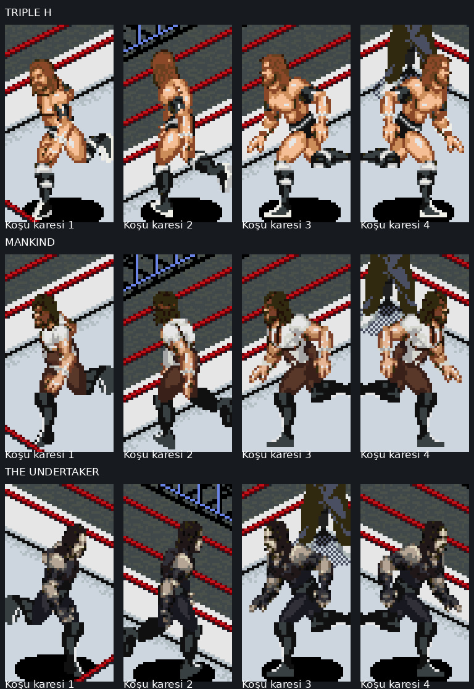
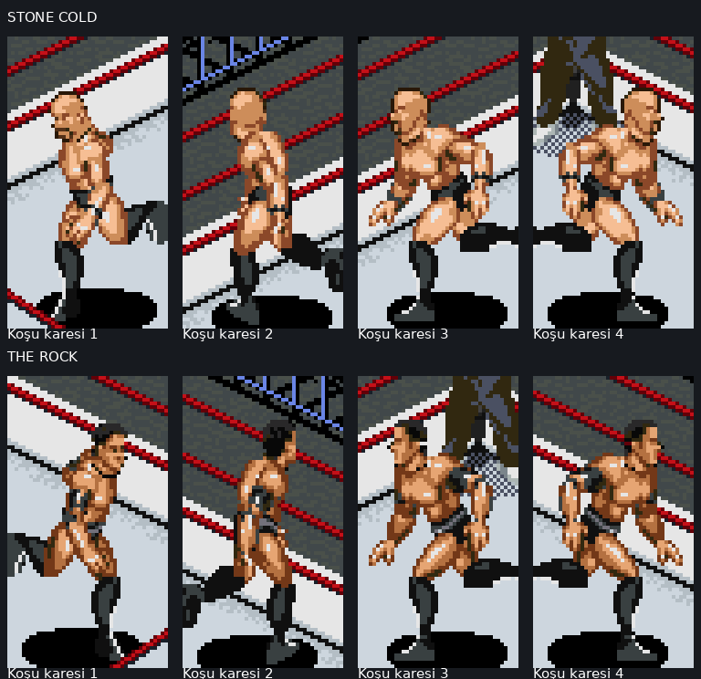
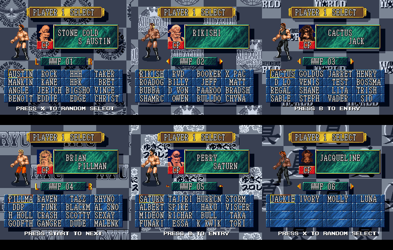
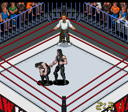
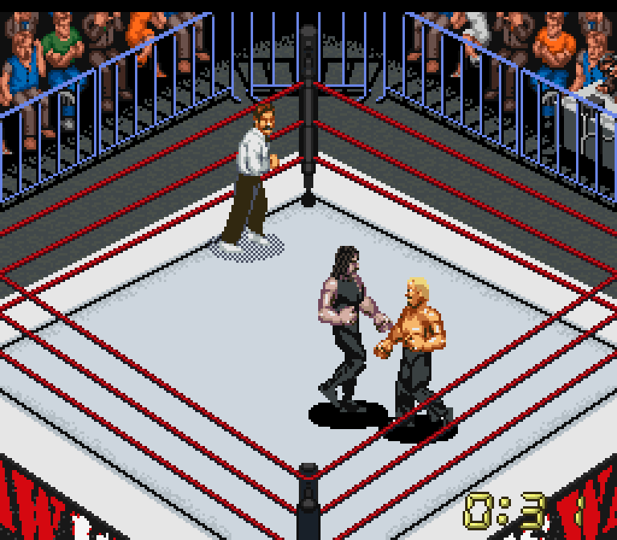
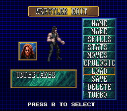
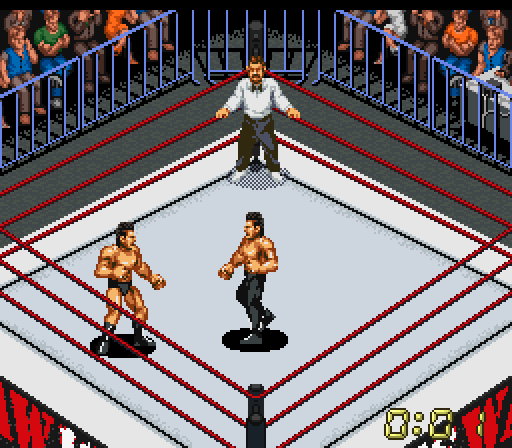
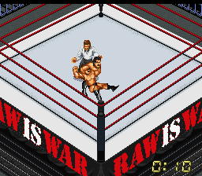

# Referanslı ilk beş karakter — güncel sürüm

[**Triple H, Mankind ve yeni Undertaker’ı içeren ROM paketini indir**](https://github.com/necaticturk-rwf/superfirex/raw/refs/heads/raw-ring-v1/downloads/raw-attitude-reference-five-v1.zip)

ZIP’i çıkarıp `raw-attitude-reference-five-v1.sfc` dosyasını Snes9x’te baştan açın. Eski save-state’i yüklemeden **DREAM MATCH → WWF 01 → HHH / TAKER / MANKIND** ile yeni maç başlatın. Ek SRAM veya EDIT’ten yükleme gerekmez.

Triple H için uzun kahverengi saç/sakal, beyaz bilek bantları ve özel siyah-beyaz diz/bot grafikleri; Mankind için deri maske, beyaz gömlek/kravat, kısa kollar ve kahverengi pantolon; Undertaker için yeni yüz/uzun siyah saç, açık ten, siyah yelek, dövmeli kollar ve ayrı el grafiklerinde siyah eldivenler hazırlandı. Üç karakterin 144 kafa açısı yenilendi.

**Beğenilen Stone Cold ve The Rock görünüşleri, RAW ring ve önem sırasına göre seçim düzeni bu pakette korunur.** Hareket/ability değerleri ve portreler önceki profillerdendir. İlk beş karakterin referans revizyonları yapılmıştır; diğer 79 görünüş henüz referanslarla yeniden hazırlanmadı. Küçük dövmeler ve logolar piksel düzeyinde yaklaşık.

[**Gerçek oyun hareket kaydı (GIF)**](reference-trio-gameplay.gif) · [Triple H seçimi](trio-hhh-selection.png) · [Mankind seçimi](trio-mankind-selection.png) · [Undertaker seçimi](trio-undertaker-selection.png)

Snes9x 1.62.3 libretro çekirdeğinde boş SRAM ile baştan açılış, 84 seçim modeli, altı sayfa, beş karakterin maç içi kafa/grafik adresleri, yeni üç karakterin dört yön koşusu/vuruşları/taunt’ları ve 3600 karelik HHH–Mankind CPU maçı doğrulandı. Ayrı 12000 karelik CPU maçında kullanılan dinamik ip grafikleri özgünleriyle karşılaştırıldı. Windows arayüzü ve diğer maç modları burada ayrıca doğrulanmadı.

[Kurulum ve kapsam](REFERENCE_FIVE_V1_TR.txt) · [Çalışma testi](reference-trio-runtime-validation.json) · [İp testi](reference-trio-rope-validation.json) · [Teknik notlar](../research/REFERENCE_TRIO_V1.md)

ROM SHA256: `cf330bb7c4e3ed3966667ee5547e6c75103c2b1baffdf60686d253e41c3f8044`.

---

Önceki sürümler:

# Stone Cold / The Rock — referans görünüş denemesi v1

[**Yeni ROM ve IPS yamalarını içeren ZIP’i indir**](https://github.com/necaticturk-rwf/superfirex/raw/refs/heads/raw-ring-v1/downloads/raw-austin-rock-reference-v1.zip)

ZIP’i çıkarıp `raw-austin-rock-reference-v1.sfc` dosyasını Snes9x’te baştan açın. Eski save-state’i yüklemeyin. **DREAM MATCH → WWF 01 → AUSTIN / ROCK**. Ek SRAM veya EDIT’ten yükleme gerekmez.

Austin’in 48 kafa açısı kel kafa ve sakalla; Rock’ın 48 kafa açısı kısa saç ve tıraşlı yüzle yeniden hazırlandı. Austin’in bileklikleri, Rock’ın dirseklikleri ve kısa tayt ayrıntıları için özel grafikler eklendi. Gövde oranları ve ekipmanları referansa göre ayarlandı. Portreler, hareketler ve ability değerleri önceki betadan korunur.

**Yalnız bu iki görünüş yenilendi. Diğer 82 görünüş önceki, kullanıcı tarafından beğenilmeyen betadan kalıyor ve ayrıca yeniden hazırlanacak. Undertaker ve kabul edilen RAW ring korunur.** Gövde anatomisi/botlar mevcut modüler parçaları kullanır; küçük kıyafet logoları okunabilir yazı değildir. Görsel benzerlik kullanıcı değerlendirmesine açık bir denemedir.

[**Gerçek oyun hareket kaydı (GIF)**](reference-pair-gameplay.gif) · [Austin seçim ekranı](austin-selection.png) · [Rock seçim ekranı](rock-selection.png)

84 seçim modeli; iki oyuncunun yeni kafa baytları/kol-gövde adresleri; dört yönde koşu, vuruş ve taunt; Undertaker CPU maçı Snes9x 1.62.3 libretro çekirdeğinde kontrol edildi. Ayrı 12000 karelik CPU maçında kullanılan dinamik ip grafikleri özgün grafiklerle karşılaştırıldı. Windows arayüzü burada çalıştırılmadı.

[Kurulum ve sınırlar](AUSTIN_ROCK_REFERENCE_V1_TR.txt) · [Çalışma testi](reference-pair-runtime-validation.json) · [İp testi](reference-pair-rope-validation.json) · [Teknik kaynak notları](../research/REFERENCE_PAIR_V1.md)

ROM SHA256: `8456e9dab3d7e6ad01b38d4dd33b9fe8b399d31fe98a2849c643cd3a930a0eee`.

---

Önceki sürümler aşağıda arşivlenmiştir. 84 kişilik betanın görünümleri son sürüm olarak kabul edilmemiştir.

# WWF Attitude Era 84 — native beta

[**84 kişilik kadro ve RAW ring içeren ZIP’i indir**](https://github.com/necaticturk-rwf/superfirex/raw/refs/heads/raw-ring-v1/downloads/raw-attitude-84-native-beta.zip)

ZIP’i çıkarıp `raw-attitude-84-native-beta.sfc` dosyasını Snes9x’te baştan açın. **DREAM MATCH → WWF 01–06**. L/R ile sayfa değiştirin. EDIT’ten yükleme veya ek SRAM dosyası gerekmez. Eski save-state yerine yeni maç başlatın.

84 yerleşik profil, 84 yeni portre, önem sırasına göre altı sayfa, karaktere göre nitelikler/hareketler/CPU tercihleri. Undertaker 1998–1999 Ministry profilidir; kabul edilen RAW ring v3 korunur.

**Bu ilk oynanabilir betada ring içi gövde çizimleri mevcut modüler parçaların uyarlamalarıdır. Kadınların karaktere özel gövde çizimleri henüz tamamlanmadı; maske, dövme ve kıyafet ayrıntıları da yaklaşık.** Bazı bitiriciler oyunun yakın animasyonlarını kullanır; örneğin Stunner → Ace Crusher, Pedigree → Tiger Driver, Crossface → STF. Giriş müzikleri oyunun mevcut sesleridir.

84/84 seçim ve maç açılışı, 117600 ek CPU karesi, altı sayfa geçişi ve 24000 karelik ip grafiği karşılaştırması Snes9x 1.62.3 libretro çekirdeğinde doğrulandı. Diğer maç modları ayrıca doğrulanmadı.

[Kurulum/sınırlar](ATTITUDE_NATIVE_BETA_TR.txt) · [84 eşleştirme](attitude-84-roster.csv) · [Bitirici karşılıkları](ATTITUDE_84_MOVESETLER.md) · [Profiller](attitude-84-profiles.json) · [Test](attitude-84-runtime-validation.json) · [Teknik notlar](../research/ATTITUDE_NATIVE_BETA.md)

[84 karakterin oyun içindeki seçim görüntüleri](attitude-84-all-selections.png)

ZIP SHA256: `c0f7cbe83d80b15eb83df2430b01214486567b437bb91de17619ccd5c07fd66c`.
ROM SHA256: `77aadb605a61430b065eafa5bcb33a52dac37ca627a6a99533949b9b9f695298`.

---

# Undertaker — Ministry 1998–1999 — v1

[**SFC + SRAM içeren paketi indir**](https://github.com/necaticturk-rwf/superfirex/raw/refs/heads/raw-ring-v1/downloads/raw-ministry-undertaker-v1.zip)

SFC ve aynı adlı SRM birlikte kullanılır. SRM'yi Snes9x'in SRAM/Battery kayıt klasörüne koyup yeni SFC'yi normal açılıştan başlatın. **DREAM MATCH → EDIT → TAKER**. Eski save state'i yüklemeyin. Önceki kayıtlarınızı bu yeni SRM ile değiştirmeyin.

Tombstone, Chokeslam, Big Boot ve Flying Clothesline; siyah kıyafet/botlar, güç/dayanıklılık ayarları ve CPU bitirici tercihleri dahil. Kabul edilen RAW ring v3 korunur. Görünüm mevcut SNES Undertaker modeline dayanır; dövme/göğüs sembolü birebir değildir.

[Kurulum ve profil notları](UNDERTAKER_MINISTRY_V1.md) · [Profil verileri](undertaker-profile.json) · [Test sonucu](undertaker-validation.json)

[Tombstone demosu](undertaker-tombstone.gif) · [Chokeslam demosu](undertaker-chokeslam.gif)

---

# RAW IS WAR ring — v3

**Güncel sürüm v3'tür. V1'de renk, v2'de ip animasyonu hatası vardır; eski paketleri kullanmayın.**

[ROM, IPS, test kaydı ve kaynak araçları içeren V3 ZIP'i indir](https://github.com/necaticturk-rwf/superfirex/raw/refs/heads/raw-ring-v1/downloads/raw-is-war-v3.zip)

ZIP'i yeni bir klasöre çıkarın. Snes9x'te **raw-is-war-v3.sfc** dosyasını açıp yeni maç başlatın. Eski maç içi save state'i kullanmayın; SRAM ilerlemesini silmek gerekmez. Hazır SFC'ye ayrıca IPS uygulamayın.

İp animasyonunun sabit grafik numaraları korunur; apron artık bu alanları kullanmaz. HWA/HWF/RANDOM aynı RAW tasarımını yükler. Açık gri mat, kırmızı ipler ve siyah/kırmızı/beyaz apron korunmuştur.

## Gerçek sekme testi kaydı

## Sekme sonrası

Snes9x 1.62.3 Linux libretro çekirdeğinde HWA, HWF ve RANDOM için dört yönde koşma/bekleme dizileri denendi. Her seçimde 2.160 kare ve 6 animasyon başlangıcı boyunca kullanılan dinamik grafikler özgün ip/köşe grafikleriyle bayt düzeyinde karşılaştırıldı. Bilgisayar maçında 16.178 oyun karesi de kontrol edildi. Windows arayüzü burada çalıştırılmadı.

[Doğrulama sonuçları](raw-is-war-v3-validation.json) · [Teknik notlar](RAW_RING_V3.md)

IPS yalnızca özgün Sydra v7 İngilizce çeviri ROM'una uygulanır; v1/v2 üzerine uygulanmaz.

ZIP SHA-256: `b5ffbcb2527a53f31230407ac442a33eb20c65a44544cf8da258e27d382cef23`.
ROM SHA-256: `f3a6e07c10d3494b398d9c0c0883736f0e47f84f75113bd64adfb2629be62474`.
