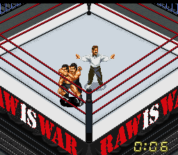
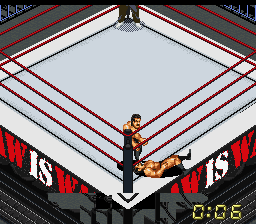
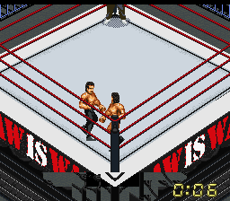

# RAW IS WAR ring — v2

**V1 renk hatası nedeniyle kullanımdan kaldırıldı. Güncel paket v2'dir.**

[ROM, IPS ve ekran görüntülerini v2 ZIP olarak indir](https://github.com/necaticturk-rwf/superfirex/raw/refs/heads/raw-ring-v1/downloads/raw-is-war-v2.zip)

ZIP'i yeni bir klasöre çıkarın. Snes9x'te **raw-is-war-v2.sfc** dosyasını açıp yeni maç başlatın. Eski maç içi save state yüklemeyin; SRAM ilerlemesini silmek gerekmez.

HWA, HWF ve RANDOM seçeneklerinde açık gri mat, kırmızı ipler, koyu köşeler ve siyah/kırmızı/beyaz RAW apronu uygulanır. V1'de bazı palet yüklemeleri eski renkleri geri getiriyordu; v2 maç sırasında da RAW paletini korur.

HWA, HWF ve RANDOM seçenekleri resmî Snes9x 1.62.3 kaynaklarından derlenmiş Linux libretro çekirdeğinde normal açılış, maç ve hareket kontrollerinden geçti. V1 SRAM ile açılış da kontrol edildi. Windows arayüzü bu ortamda çalıştırılmadı.

## HWA

## HWF

## RANDOM

Hazır SFC kullanılıyorsa ayrıca IPS uygulanmaz. IPS yalnızca özgün Sydra v7 İngilizce çeviri ROM'una uygulanır; v1 üzerine uygulanmaz.

[Teknik düzeltme ve doğrulama notları](RAW_RING_V2.md)

ZIP SHA-256: `0c6eda11e48331d10da0487bc4fb823fb0e6c18d18d342508a100eddc7ce6abd`.
ROM SHA-256: `7c009543e715b18e67ff5bdba47e2a9b51572b6de1445d87fc566781413dcefe`.
