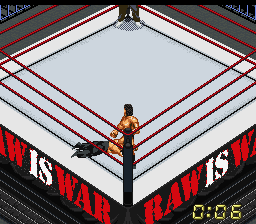
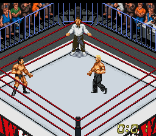

# RAW IS WAR ring — ilk sürüm

[ROM, IPS yaması ve ekran görüntülerini ZIP olarak indir](https://github.com/necaticturk-rwf/superfirex/raw/refs/heads/raw-ring-v1/downloads/raw-is-war-v1.zip)

ZIP içindeki `raw-is-war-v1.sfc` dosyasını SNES emülatöründe açın. **HWA ringini seçip yeni maç başlatın.** Eski maç içi save state dosyalarını yüklemeyin.

Açık gri ve logosuz mat, kırmızı ipler, koyu köşeler ve siyah apron üzerinde kırmızı-beyaz RAW IS WAR yazısı uygulanmıştır.

IPS yaması yalnızca depodaki Sydra v7 İngilizce çeviri ROM'u içindir. Orijinal ROM SHA-256: `30a774f32e3e132d7e0c16f964a59b8720c1cc081e20159f85a22635f13e28fa`.

Yamalı ROM, normal açılıştan maça geçiş ve hareket kontrolleriyle Snes9x üzerinde doğrulandı. İlk sürümün doğrulama hedefi HWA ringidir; diğer ring seçenekleri doğrulanmadı.

ZIP SHA-256: `50b16cb113fd7acbcffe24cd5b1e7e75526d5d7da3a63b5af1741551c06ab62a`.
